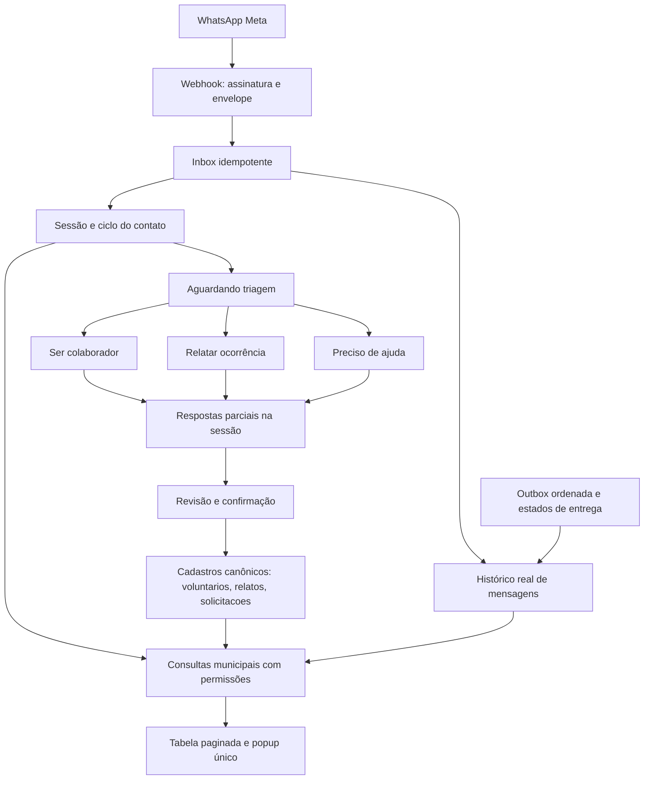

# Contatos e atendimentos

Implementação aprovada para `/gestao/#voluntarios`, a partir da auditoria do LifeSinal. A identidade continua em `wa.sessions`, única por canal e remetente verificado; não foi criada uma segunda tabela de pessoas.

## Hierarquia

Categorias e andamento são eixos distintos. Perguntas, opções, imagens e respostas do fluxo continuam no catálogo canônico v2, imutável e publicado no banco. Rótulos, colunas, agrupamento das etapas, limite da página e intervalo da atualização ficam em `ma_configuracao.contatos`. O navegador apenas apresenta os resultados das RPCs.

## Módulos

- `contatos_ciclo`: primeiro contato aceito na inbox, perfil com procedência, auditoria de ciclos, proteção da fila e exclusão lógica dos cadastros.
- `contatos_catalogo`: configuração editorial e apresentação no banco.
- `contatos_leitura`: consulta por prefeitura, categoria, etapa, texto e página; une sessões reais e cadastros manuais sem relacioná-los pelo telefone declarado.
- `contatos_detalhe`: respostas condicionais, registros confirmados e mensagens reais paginadas. Fotografias privadas usam URLs assinadas temporárias.
- `contatos_exclusao`: permissão, versão esperada, vínculos operacionais, bloqueio durante entrega incerta/em andamento, cancelamento da fila e auditoria.
- Frontend separado em serviço, apresentação, diálogo e orquestração. Atualiza a cada oito segundos enquanto visível; preserva a rota e o foco. O botão amarelo `+` usa o formulário existente.

Relatos e solicitações confirmados permanecem nos seus registros operacionais após excluir o contato. Colaborações e pontos públicos vinculados são arquivados, sem exclusão física. A RLS oculta registros arquivados das consultas normais. Referências operacionais impedem o arquivamento. Reenvio de webhook ou evento anterior à exclusão não reabre o contato. Uma mensagem nova inicia outro ciclo auditado; uma oferta só volta ao cadastro ativo após nova confirmação.

Os leitores públicos da API são `SECURITY INVOKER`; as funções privadas verificam usuário e prefeitura. Tabelas e funções auxiliares do domínio WhatsApp não são consultáveis diretamente pelo navegador. A conversa completa exige leitura das três coleções, porque pode conter atendimentos de categorias anteriores.

## Validação

- 278 testes Node de interface, regressão e contratos, incluindo a câmera canônica dos mapas.
- Oito testes Deno de assinatura, parser, mídia, transporte e procedência do perfil.
- Onze suítes SQL em PostgreSQL descartável: catálogo, três fluxos, cópia canônica, pipeline, permissões e demais contratos municipais.
- Pipeline: visibilidade antes do processamento, progresso sem avançar em resposta inválida, confirmação sem duplicar linha, isolamento de cadastro manual, exclusão concorrente com envio, replay, evento atrasado, reabertura e RLS real sob papel autenticado.
- Conferência no Chrome: tabela, popup sem navegação, conversa, Escape e foco de retorno; layout em 390 × 844 e desktop.

Não foram enviados testes para cidadãos nem criados cadastros fictícios em produção. A entrega de uma nova conversa ponta a ponta no aparelho depende de uma mensagem real posterior à publicação; os testes de fluxo usaram filas locais, sem chamada à Meta.

Referências de implementação: [RLS](https://supabase.com/docs/guides/database/postgres/row-level-security) e [acesso ao Storage](https://supabase.com/docs/guides/storage/security/access-control).

## Conferência em produção

Em 07/11/2026 à noite (Brasília), o contato real anterior passou a aparecer como Aguardando triagem. O popup abriu na própria rota e mostrou as mensagens recebidas, os botões enviados e os estados de leitura. As cinco migrações iniciais foram aplicadas; o webhook foi republicado com captura limitada do nome de perfil. A versão de atendimento permaneceu `municipal-v2-canonico`, sem entradas pendentes. A consulta anônima e a leitura direta de sessões permanecem negadas.

O histórico contém duas entradas de imagem anteriores ao pipeline, sem objetos correspondentes no armazenamento privado. A interface informa a indisponibilidade. A recuperação de referência só é permitida quando o arquivo privado exato já existe, sem reconstruir ou publicar fotos de cidadãos. Esse caminho tem teste próprio e a suíte SQL do pipeline foi incluída no CI.
